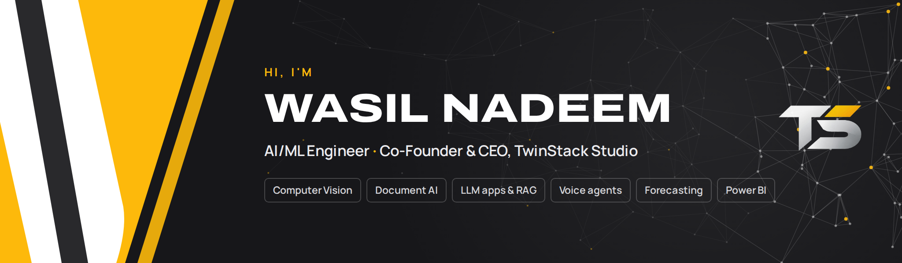

I build AI systems that do real work: models that read shelves, invoices and sensor data, and the apps and dashboards people use them through. I run [TwinStack Studio](https://twinstackstudio.com) from Islamabad with my co-founder, and most of my work lives in the [twinstack-studio](https://github.com/twinstack-studio) organisation.

I like taking a model from a notebook to something a business can open in the browser, tested on data it never saw during training, with the numbers written down honestly.

### What I work on

- **Computer vision:** object detection and counting with YOLO, fine-tuned on GPU, plus camera footage and gaps on retail shelves
- **Document AI:** OCR and field extraction for invoices, receipts and utility bills
- **LLM apps:** chat assistants that answer from SQL and documents, and voice agents that take calls and book appointments
- **Machine learning:** forecasting, fault detection and price prediction with gradient boosting
- **Data and BI:** ETL in Python and SQL, Power BI reports and analytics dashboards

### Selected projects

Each one has a live demo and a public project page. The source code is kept private.

| Project | What it does | Links |
| --- | --- | --- |
| **ShelfSense** | Retail AI: shelf scanner, store camera, 3D store map, demand forecast and a question-answering assistant | [Demo](https://shelfsense.twinstackstudio.com) · [Project](https://github.com/twinstack-studio/shelfsense) |
| **Shelf detector** | YOLO11s fine-tuned on SKU-110K: mAP@50 0.941 on the test split, up from 0.384 before training. Scripts, weights and results are public | [Repo](https://github.com/twinstack-studio/shelf-detector) |
| **DocuMind** | Reads invoices, receipts and Pakistani utility bills into fields, then runs payables, vendor statements and a sales tax register | [Demo](https://documind.twinstackstudio.com) · [Project](https://github.com/twinstack-studio/documind) |
| **AirSentinel** | Finds faults in building air-handling units from sensor readings, with alarms, maintenance and energy reports | [Demo](https://airsentinel.twinstackstudio.com) · [Project](https://github.com/twinstack-studio/airsentinel) |
| **RentVoice** | Voice agent for a rental company that answers calls about listings and takes enquiries | [Demo](https://rentvoice.twinstackstudio.com) · [Project](https://github.com/twinstack-studio/rentvoice) |
| **DriveWorth** | Car and bike price estimates for the Pakistani market, trained on real listings | [Demo](https://driveworth.twinstackstudio.com) · [Project](https://github.com/twinstack-studio/driveworth) |
| **Threadline** | Fashion retail analytics with a returns desk, buy planning and a Power BI report | [Demo](https://threadline.twinstackstudio.com) · [Project](https://github.com/twinstack-studio/threadline) |
| **CardLens** | Credit card analytics: customer segments, risk, collections queue and management reports | [Demo](https://cardlens.twinstackstudio.com) · [Project](https://github.com/twinstack-studio/cardlens) |

### Tools I use

### Contact

[Website](https://twinstackstudio.com) · [Email](mailto:wasilbhatti47@gmail.com) · [TwinStack on LinkedIn](https://www.linkedin.com/company/twinstack-studio)

BS Computer Science, COMSATS University Islamabad (2024).
